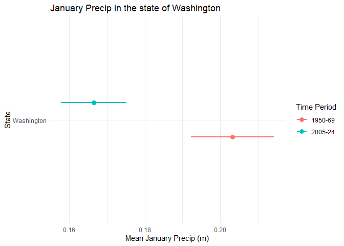
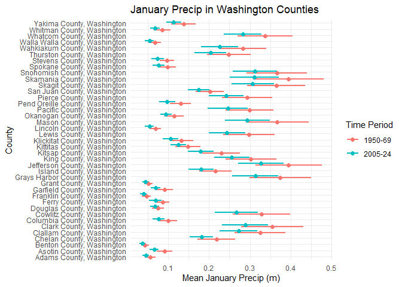
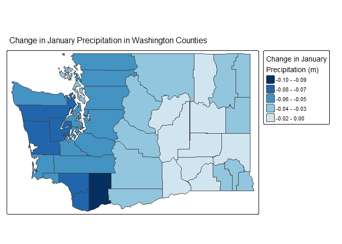

Geog 4/6300: Lab 3-Confidence intervals
================

## Confidence intervals

**Your name: Selena Centeno**

**Overview:**

In this lab, we will create confidence intervals for January
precipitation in Washington during two time periods: 1950-1969 and
2005-2024. Using county-level precipitation data from the ERA5 dataset,
you will estimate statewide precipitation patterns, then examine
variation and change at the county level. We’ve summed the precipitation
in January for each county over two twenty year time periods: 1950-1969
and 2005-2024. You’ll be using those data to create confidence intervals
at a state and county level.

To load these data, load the csv file, which is included in the data
folder:

``` r
era5_data<-read_csv("data/precip_uswest_era5.csv")
```

This is a long format dataset including county identifiers, county
population, median household income, and poverty rate. Census figures
are based on the 2018-22 ACS. The last two columns (year, prcp_m,
time_range) give the year and total precipitation in meters from the
ERA5 NetCDF file, and two time ranges (1950-1969 and 2005-2024).

The script used to create this dataframe is also provided in this
repository (‘lab3_dataprep’), along with rasters of the yearly mean
total precipitation for Januaries in the two time periods of interest.

For this lab to be marked complete, it must demonstrate the following
learning standards:

- 11. Create effective data visualizations across multiple chart types
      (line, scatter, histogram, Q-Q plot), applying appropriate
      aesthetic choices such as color, grouping, and labeling. (Tasks 2
      and 5)
- 12. Produce and interpret confidence interval plots that enable visual
      comparison of means and uncertainty across groups or time periods.
      (Tasks 2, 3, 5, and 6)
- 13. Visualize spatial data using appropriate mapping tools, selecting
      suitable classification schemes and cartographic elements to
      support clear communication. (Task 7)
- 14. Arrange and present tabular results in a readable format
      appropriate for a technical document or report. (Tasks 1 and 4)
- 15. Use measures of central tendency and dispersion to describe the
      variables in tabular datasets (Tasks 1 and 4)
- 20. Explaining how evidence from a sample supports conclusions about a
      population while acknowledging sampling variability and
      uncertainty. (Tasks 3 and 6)
- 22. Construct and interpret confidence intervals, explaining how
      factors such as sample size and spatial scale affect the precision
      of an estimate. (Tasks 1, 3, 4 and 6)

# Part 1: Calculating statewide confidence intervals for Washington’s precipitation

In the first part of this lab, you’ll determine a confidence interval
for Washington’s precipitation for these two time periods. This can be
helpful in identifying whether precipitation has changed across the
state (e.g., whether the two confidence intervals overlap) using the
county data as your sample.

**Task 1** *Load the data and filter it to just include data for the
state of Washington. Then create a table showing mean precipitation,
standard deviation, number of observations (sample size), and
upper/lower confidence interval bounds for each of the two time periods
in the `time_range` field. Use `kable` to display the table when you are
done.*

``` r
#Filtering the data for just Washington:
wash_data<- era5_data %>%
  filter(st_name == "Washington")
#Calculating the stats + U/L CI's
wash_stats_table<- wash_data %>%
  group_by(time_range) %>%
  summarise(mean_prcp = mean(prcp_m), sd_prcp = sd(prcp_m), n = n(), se = sd_prcp/sqrt(n),
            lower_ci = mean_prcp - qt(0.975, df = n-1)*se,
            upper_ci = mean_prcp + qt(0.975, df = n-1)*se)
#Using kable to display the table:
knitr::kable(wash_stats_table)
```

| time_range | mean_prcp |   sd_prcp |   n |        se |  lower_ci |  upper_ci |
|:-----------|----------:|----------:|----:|----------:|----------:|----------:|
| 1950-69    | 0.2032239 | 0.1562948 | 780 | 0.0055963 | 0.1922383 | 0.2142094 |
| 2005-24    | 0.1664626 | 0.1230138 | 780 | 0.0044046 | 0.1578163 | 0.1751089 |

Using the code provided in class, create a ggplot graphic that
visualizes these two confidence intervals. You’ll want to use
`geom_point` and `geom_linerange` to do so. Use states as the y-axis and
mean precipitation as the x axis. Vary the color and position of the
dots and lines for the mean/CI by the `time_range` variable. Feel free
to also experiment with axis labels/themes to make the graph more
appealing and accessible.

**Task 2** *Create a ggplot graphic as described above to show the
confidence intervals for precipitation in Washington for each time
range.*

``` r
#Code provided in class -- make code that looks something like this below (but for this lab's case).
#ggplot(cps_data_hisp) +
  #geom_linerange(aes(xmin=ci_low,xmax=ci_high,y=reorder(STATE,mex_pct),group=STATE))+
  #geom_point(aes(x=mex_pct,y=STATE))
#--------------------------------------------------------------------------------------------------------------------
ggplot(wash_stats_table, aes(y="Washington", color=time_range))+
  geom_linerange(
    aes(xmin=lower_ci, xmax=upper_ci),
    position = position_dodge(width = 0.4),
    linewidth = 1) +
  geom_point(aes(x=mean_prcp), position = position_dodge(width = 0.4),
             size = 3) +
  labs(title = "January Precip in the state of Washington", x="Mean January Precip (m)", y="State", color = "Time Period") + theme_minimal()
```

<!-- -->

**Task 3** *Interpret your table and graph. What do they tell us about
the change in Washington’s precipitation during this time?*

The mean precipitation in January in Washington has decreased by a
respectable amount (looks to be around 0.03ish meters). Also noting that
the confidence intervals do not overlap, which would suggest that there
is a bigger/more meaningful change in the state’s precip in January.
These 95% confidence intervals show the uncertainty surrounding each one
of the means.

# Part 2: Analyzing county data in Washington.

In part 1, you ran a state level analysis. What if you wanted to
identify where populations might be negatively affected by precipitation
changes within a state? In this section, you’ll look at the changes in
precipitation **at county level** in Washington to

To start with, adapt your code from step 1 so that you create confidence
intervals for **counties** instead of states. After creating that
dataset, create another ggplot graph of those confidence intervals that
you can compare to the state level data in Task 2 to examine how
precipitation has changed across counties in Washington.

**Task 4** *Create a summary table for January precipitation in
Washington counties for both time periods. Use the same approach as in
Task 1, but calculate statistics for counties rather than the state as a
whole. Call the head of your table with `kable` when you are done.*

``` r
#Making the table for the counties instead of just the state + calculating the stats:
wash_counties_table<- wash_data %>%
  group_by(cty_name, time_range) %>%
  summarise(mean_prcp = mean(prcp_m), sd_prcp = sd(prcp_m), n = n(), se = sd_prcp/sqrt(n),
            lower_ci = mean_prcp - qt(0.975, df = n-1)*se,
            upper_ci = mean_prcp + qt(0.975, df = n-1)*se,)
```

    ## `summarise()` has regrouped the output.
    ## ℹ Summaries were computed grouped by cty_name and time_range.
    ## ℹ Output is grouped by cty_name.
    ## ℹ Use `summarise(.groups = "drop_last")` to silence this message.
    ## ℹ Use `summarise(.by = c(cty_name, time_range))` for per-operation grouping
    ##   (`?dplyr::dplyr_by`) instead.

``` r
#Using kable to display the table
knitr::kable(wash_counties_table)
```

| cty_name | time_range | mean_prcp | sd_prcp | n | se | lower_ci | upper_ci |
|:---|:---|---:|---:|---:|---:|---:|---:|
| Adams County, Washington | 1950-69 | 0.0561916 | 0.0275746 | 20 | 0.0061659 | 0.0432862 | 0.0690969 |
| Adams County, Washington | 2005-24 | 0.0455177 | 0.0183023 | 20 | 0.0040925 | 0.0369519 | 0.0540834 |
| Asotin County, Washington | 1950-69 | 0.0917109 | 0.0412774 | 20 | 0.0092299 | 0.0723925 | 0.1110293 |
| Asotin County, Washington | 2005-24 | 0.0661066 | 0.0238369 | 20 | 0.0053301 | 0.0549506 | 0.0772627 |
| Benton County, Washington | 1950-69 | 0.0439175 | 0.0199657 | 20 | 0.0044645 | 0.0345733 | 0.0532617 |
| Benton County, Washington | 2005-24 | 0.0377814 | 0.0152653 | 20 | 0.0034134 | 0.0306370 | 0.0449258 |
| Chelan County, Washington | 1950-69 | 0.2184237 | 0.0983827 | 20 | 0.0219991 | 0.1723791 | 0.2644682 |
| Chelan County, Washington | 2005-24 | 0.1817817 | 0.0613328 | 20 | 0.0137144 | 0.1530770 | 0.2104863 |
| Clallam County, Washington | 1950-69 | 0.3252100 | 0.1331571 | 20 | 0.0297748 | 0.2628905 | 0.3875295 |
| Clallam County, Washington | 2005-24 | 0.2724353 | 0.0979751 | 20 | 0.0219079 | 0.2265815 | 0.3182891 |
| Clark County, Washington | 1950-69 | 0.3545254 | 0.1621728 | 20 | 0.0362629 | 0.2786262 | 0.4304247 |
| Clark County, Washington | 2005-24 | 0.2886253 | 0.1206821 | 20 | 0.0269853 | 0.2321443 | 0.3451063 |
| Columbia County, Washington | 1950-69 | 0.1004024 | 0.0475038 | 20 | 0.0106222 | 0.0781699 | 0.1226349 |
| Columbia County, Washington | 2005-24 | 0.0771332 | 0.0302954 | 20 | 0.0067743 | 0.0629545 | 0.0913119 |
| Cowlitz County, Washington | 1950-69 | 0.3290205 | 0.1501020 | 20 | 0.0335638 | 0.2587706 | 0.3992704 |
| Cowlitz County, Washington | 2005-24 | 0.2670517 | 0.1120230 | 20 | 0.0250491 | 0.2146233 | 0.3194801 |
| Douglas County, Washington | 1950-69 | 0.0755475 | 0.0305795 | 20 | 0.0068378 | 0.0612358 | 0.0898591 |
| Douglas County, Washington | 2005-24 | 0.0677107 | 0.0237489 | 20 | 0.0053104 | 0.0565959 | 0.0788255 |
| Ferry County, Washington | 1950-69 | 0.0872902 | 0.0340067 | 20 | 0.0076041 | 0.0713745 | 0.1032058 |
| Ferry County, Washington | 2005-24 | 0.0690214 | 0.0318703 | 20 | 0.0071264 | 0.0541057 | 0.0839372 |
| Franklin County, Washington | 1950-69 | 0.0471717 | 0.0234902 | 20 | 0.0052526 | 0.0361780 | 0.0581654 |
| Franklin County, Washington | 2005-24 | 0.0396481 | 0.0162463 | 20 | 0.0036328 | 0.0320446 | 0.0472517 |
| Garfield County, Washington | 1950-69 | 0.0911108 | 0.0432525 | 20 | 0.0096716 | 0.0708681 | 0.1113536 |
| Garfield County, Washington | 2005-24 | 0.0695885 | 0.0257205 | 20 | 0.0057513 | 0.0575510 | 0.0816261 |
| Grant County, Washington | 1950-69 | 0.0515536 | 0.0214117 | 20 | 0.0047878 | 0.0415327 | 0.0615746 |
| Grant County, Washington | 2005-24 | 0.0452047 | 0.0166150 | 20 | 0.0037152 | 0.0374287 | 0.0529808 |
| Grays Harbor County, Washington | 1950-69 | 0.3744625 | 0.1624178 | 20 | 0.0363177 | 0.2984486 | 0.4504764 |
| Grays Harbor County, Washington | 2005-24 | 0.3134319 | 0.1198127 | 20 | 0.0267909 | 0.2573578 | 0.3695060 |
| Island County, Washington | 1950-69 | 0.2155585 | 0.0854027 | 20 | 0.0190966 | 0.1755888 | 0.2555282 |
| Island County, Washington | 2005-24 | 0.1810308 | 0.0653799 | 20 | 0.0146194 | 0.1504321 | 0.2116296 |
| Jefferson County, Washington | 1950-69 | 0.3949528 | 0.1741901 | 20 | 0.0389501 | 0.3134293 | 0.4764763 |
| Jefferson County, Washington | 2005-24 | 0.3272575 | 0.1196150 | 20 | 0.0267467 | 0.2712760 | 0.3832391 |
| King County, Washington | 1950-69 | 0.3027204 | 0.1330477 | 20 | 0.0297504 | 0.2404521 | 0.3649886 |
| King County, Washington | 2005-24 | 0.2557177 | 0.0919941 | 20 | 0.0205705 | 0.2126631 | 0.2987722 |
| Kitsap County, Washington | 1950-69 | 0.2298190 | 0.0985732 | 20 | 0.0220416 | 0.1836853 | 0.2759526 |
| Kitsap County, Washington | 2005-24 | 0.1797918 | 0.0671085 | 20 | 0.0150059 | 0.1483840 | 0.2111995 |
| Kittitas County, Washington | 1950-69 | 0.1483310 | 0.0667248 | 20 | 0.0149201 | 0.1171029 | 0.1795592 |
| Kittitas County, Washington | 2005-24 | 0.1245704 | 0.0403266 | 20 | 0.0090173 | 0.1056970 | 0.1434439 |
| Klickitat County, Washington | 1950-69 | 0.1327846 | 0.0603296 | 20 | 0.0134901 | 0.1045494 | 0.1610197 |
| Klickitat County, Washington | 2005-24 | 0.1060991 | 0.0408844 | 20 | 0.0091420 | 0.0869646 | 0.1252336 |
| Lewis County, Washington | 1950-69 | 0.2980728 | 0.1346273 | 20 | 0.0301036 | 0.2350653 | 0.3610803 |
| Lewis County, Washington | 2005-24 | 0.2437228 | 0.0952494 | 20 | 0.0212984 | 0.1991447 | 0.2883009 |
| Lincoln County, Washington | 1950-69 | 0.0690049 | 0.0296052 | 20 | 0.0066199 | 0.0551492 | 0.0828606 |
| Lincoln County, Washington | 2005-24 | 0.0547771 | 0.0232163 | 20 | 0.0051913 | 0.0439115 | 0.0656427 |
| Mason County, Washington | 1950-69 | 0.3667742 | 0.1645045 | 20 | 0.0367843 | 0.2897837 | 0.4437646 |
| Mason County, Washington | 2005-24 | 0.2940343 | 0.1157409 | 20 | 0.0258805 | 0.2398659 | 0.3482027 |
| Okanogan County, Washington | 1950-69 | 0.1151731 | 0.0492290 | 20 | 0.0110079 | 0.0921333 | 0.1382130 |
| Okanogan County, Washington | 2005-24 | 0.0949922 | 0.0305825 | 20 | 0.0068385 | 0.0806791 | 0.1093052 |
| Pacific County, Washington | 1950-69 | 0.2992748 | 0.1259111 | 20 | 0.0281546 | 0.2403466 | 0.3582030 |
| Pacific County, Washington | 2005-24 | 0.2460436 | 0.1056389 | 20 | 0.0236216 | 0.1966030 | 0.2954841 |
| Pend Oreille County, Washington | 1950-69 | 0.1303871 | 0.0546806 | 20 | 0.0122270 | 0.1047958 | 0.1559784 |
| Pend Oreille County, Washington | 2005-24 | 0.0978301 | 0.0429671 | 20 | 0.0096077 | 0.0777209 | 0.1179394 |
| Pierce County, Washington | 1950-69 | 0.2933901 | 0.1318172 | 20 | 0.0294752 | 0.2316977 | 0.3550824 |
| Pierce County, Washington | 2005-24 | 0.2421974 | 0.0893287 | 20 | 0.0199745 | 0.2003903 | 0.2840045 |
| San Juan County, Washington | 1950-69 | 0.2023890 | 0.0737337 | 20 | 0.0164874 | 0.1678805 | 0.2368974 |
| San Juan County, Washington | 2005-24 | 0.1744785 | 0.0564386 | 20 | 0.0126200 | 0.1480645 | 0.2008926 |
| Skagit County, Washington | 1950-69 | 0.3644765 | 0.1521314 | 20 | 0.0340176 | 0.2932768 | 0.4356762 |
| Skagit County, Washington | 2005-24 | 0.3067599 | 0.1106866 | 20 | 0.0247503 | 0.2549569 | 0.3585628 |
| Skamania County, Washington | 1950-69 | 0.3942506 | 0.1831491 | 20 | 0.0409534 | 0.3085342 | 0.4799670 |
| Skamania County, Washington | 2005-24 | 0.3103656 | 0.1283386 | 20 | 0.0286974 | 0.2503013 | 0.3704299 |
| Snohomish County, Washington | 1950-69 | 0.3658901 | 0.1571137 | 20 | 0.0351317 | 0.2923586 | 0.4394216 |
| Snohomish County, Washington | 2005-24 | 0.3123520 | 0.1152938 | 20 | 0.0257805 | 0.2583929 | 0.3663112 |
| Spokane County, Washington | 1950-69 | 0.0983015 | 0.0448093 | 20 | 0.0100197 | 0.0773300 | 0.1192729 |
| Spokane County, Washington | 2005-24 | 0.0761750 | 0.0312343 | 20 | 0.0069842 | 0.0615569 | 0.0907931 |
| Stevens County, Washington | 1950-69 | 0.0974383 | 0.0371358 | 20 | 0.0083038 | 0.0800582 | 0.1148184 |
| Stevens County, Washington | 2005-24 | 0.0744463 | 0.0326261 | 20 | 0.0072954 | 0.0591768 | 0.0897158 |
| Thurston County, Washington | 1950-69 | 0.2486569 | 0.1132318 | 20 | 0.0253194 | 0.1956628 | 0.3016510 |
| Thurston County, Washington | 2005-24 | 0.2034090 | 0.0827510 | 20 | 0.0185037 | 0.1646804 | 0.2421377 |
| Wahkiakum County, Washington | 1950-69 | 0.2836752 | 0.1204220 | 20 | 0.0269272 | 0.2273160 | 0.3400344 |
| Wahkiakum County, Washington | 2005-24 | 0.2261165 | 0.0975296 | 20 | 0.0218083 | 0.1804713 | 0.2717618 |
| Walla Walla County, Washington | 1950-69 | 0.0673853 | 0.0326224 | 20 | 0.0072946 | 0.0521176 | 0.0826531 |
| Walla Walla County, Washington | 2005-24 | 0.0542915 | 0.0230428 | 20 | 0.0051525 | 0.0435071 | 0.0650758 |
| Whatcom County, Washington | 1950-69 | 0.3371718 | 0.1432597 | 20 | 0.0320338 | 0.2701242 | 0.4042194 |
| Whatcom County, Washington | 2005-24 | 0.2825477 | 0.0981786 | 20 | 0.0219534 | 0.2365987 | 0.3284967 |
| Whitman County, Washington | 1950-69 | 0.0855892 | 0.0426485 | 20 | 0.0095365 | 0.0656291 | 0.1055493 |
| Whitman County, Washington | 2005-24 | 0.0678525 | 0.0250818 | 20 | 0.0056085 | 0.0561138 | 0.0795912 |
| Yakima County, Washington | 1950-69 | 0.1377246 | 0.0637040 | 20 | 0.0142446 | 0.1079102 | 0.1675390 |
| Yakima County, Washington | 2005-24 | 0.1141443 | 0.0395149 | 20 | 0.0088358 | 0.0956508 | 0.1326379 |

**Task 5** *Visualize the confidence intervals for the county-level data
you generated in task 4, using the same style as you did for Task 2
above. For an optional extra challenge, visually highlight the counties
where the confidence intervals between time periods do NOT overlap.*

``` r
#Making the ggplot for the county data:
ggplot(wash_counties_table, aes(y=cty_name, color=time_range))+
  geom_linerange(aes(xmin=lower_ci, xmax=upper_ci), position=position_dodge(width = 0.6), linewidth = 0.8) +
  geom_point(aes(x=mean_prcp), position = position_dodge(width = 0.6), size = 2) +
  labs(title = "January Precip in Washington Counties",
       x="Mean January Precip (m)",
       y="County",
       color = "Time Period") + theme_minimal()
```

<!-- -->

**Task 6**: *Compare the size of the error terms for your county level
data to the error terms at state level that you calculated in Task 1.
Are they bigger or smaller? Explain why the formula you used for
calculating the error terms produced error terms of different sizes. How
is this difference visible in your ggplot graphs?*

I’m keeping in mind that as the sample size increases, the standard
error decreases because you are dividing by a larger number. With that
said, the error terms for the county level data are generally larger
than those in the state level. The sample sizes are very different: at
the state level, n=780, whereas at the county level, n=20. The general
standard error (se) formula is s/sqrt(n), so the “s” is sd_prcp, and “n”
is the number of obs. The smaller sample size at the county level
generally produced larger error terms. You can see this in the ggplots,
as the county level confidence interval lines tend to have a longer
lines compared to the state level confidence intervals. These confidence
interval differences between the scales are also evident in the tables
themselves. So, the wider the horizontal lines, the greater the
uncertainty… in the county level precipitation estimates.

**Task 7**: *Transform the county data from task 4 into wide format so
that the means for each time period are in the same row for each county.
Then calculate the change in precipitation between the time periods.
Join this table to the geopackage file that contains county boundaries
and census data, making sure that you only have Washington counties
included - use the geopackage `data/acsdata_cty_westreg.gpkg`. Then use
`tmap` to map out the difference in precipitation means across the two
time periods. Make sure the legend of this map is interpretable.*

``` r
#Making the county data in wide format:
wash_counties_wide<- wash_counties_table %>%
  select(cty_name, time_range, mean_prcp) %>%
  pivot_wider(names_from = time_range, values_from = mean_prcp)
knitr::kable(wash_counties_wide) #bc why not
```

| cty_name                        |   1950-69 |   2005-24 |
|:--------------------------------|----------:|----------:|
| Adams County, Washington        | 0.0561916 | 0.0455177 |
| Asotin County, Washington       | 0.0917109 | 0.0661066 |
| Benton County, Washington       | 0.0439175 | 0.0377814 |
| Chelan County, Washington       | 0.2184237 | 0.1817817 |
| Clallam County, Washington      | 0.3252100 | 0.2724353 |
| Clark County, Washington        | 0.3545254 | 0.2886253 |
| Columbia County, Washington     | 0.1004024 | 0.0771332 |
| Cowlitz County, Washington      | 0.3290205 | 0.2670517 |
| Douglas County, Washington      | 0.0755475 | 0.0677107 |
| Ferry County, Washington        | 0.0872902 | 0.0690214 |
| Franklin County, Washington     | 0.0471717 | 0.0396481 |
| Garfield County, Washington     | 0.0911108 | 0.0695885 |
| Grant County, Washington        | 0.0515536 | 0.0452047 |
| Grays Harbor County, Washington | 0.3744625 | 0.3134319 |
| Island County, Washington       | 0.2155585 | 0.1810308 |
| Jefferson County, Washington    | 0.3949528 | 0.3272575 |
| King County, Washington         | 0.3027204 | 0.2557177 |
| Kitsap County, Washington       | 0.2298190 | 0.1797918 |
| Kittitas County, Washington     | 0.1483310 | 0.1245704 |
| Klickitat County, Washington    | 0.1327846 | 0.1060991 |
| Lewis County, Washington        | 0.2980728 | 0.2437228 |
| Lincoln County, Washington      | 0.0690049 | 0.0547771 |
| Mason County, Washington        | 0.3667742 | 0.2940343 |
| Okanogan County, Washington     | 0.1151731 | 0.0949922 |
| Pacific County, Washington      | 0.2992748 | 0.2460436 |
| Pend Oreille County, Washington | 0.1303871 | 0.0978301 |
| Pierce County, Washington       | 0.2933901 | 0.2421974 |
| San Juan County, Washington     | 0.2023890 | 0.1744785 |
| Skagit County, Washington       | 0.3644765 | 0.3067599 |
| Skamania County, Washington     | 0.3942506 | 0.3103656 |
| Snohomish County, Washington    | 0.3658901 | 0.3123520 |
| Spokane County, Washington      | 0.0983015 | 0.0761750 |
| Stevens County, Washington      | 0.0974383 | 0.0744463 |
| Thurston County, Washington     | 0.2486569 | 0.2034090 |
| Wahkiakum County, Washington    | 0.2836752 | 0.2261165 |
| Walla Walla County, Washington  | 0.0673853 | 0.0542915 |
| Whatcom County, Washington      | 0.3371718 | 0.2825477 |
| Whitman County, Washington      | 0.0855892 | 0.0678525 |
| Yakima County, Washington       | 0.1377246 | 0.1141443 |

``` r
#Calculating the change in precip between the time periods:
wash_counties_wide<- wash_counties_wide %>%
  mutate(prcp_change = `2005-24` - `1950-69`)
knitr::kable(wash_counties_wide) #bc why not
```

| cty_name                        |   1950-69 |   2005-24 | prcp_change |
|:--------------------------------|----------:|----------:|------------:|
| Adams County, Washington        | 0.0561916 | 0.0455177 |  -0.0106739 |
| Asotin County, Washington       | 0.0917109 | 0.0661066 |  -0.0256043 |
| Benton County, Washington       | 0.0439175 | 0.0377814 |  -0.0061361 |
| Chelan County, Washington       | 0.2184237 | 0.1817817 |  -0.0366420 |
| Clallam County, Washington      | 0.3252100 | 0.2724353 |  -0.0527747 |
| Clark County, Washington        | 0.3545254 | 0.2886253 |  -0.0659001 |
| Columbia County, Washington     | 0.1004024 | 0.0771332 |  -0.0232692 |
| Cowlitz County, Washington      | 0.3290205 | 0.2670517 |  -0.0619688 |
| Douglas County, Washington      | 0.0755475 | 0.0677107 |  -0.0078367 |
| Ferry County, Washington        | 0.0872902 | 0.0690214 |  -0.0182687 |
| Franklin County, Washington     | 0.0471717 | 0.0396481 |  -0.0075235 |
| Garfield County, Washington     | 0.0911108 | 0.0695885 |  -0.0215223 |
| Grant County, Washington        | 0.0515536 | 0.0452047 |  -0.0063489 |
| Grays Harbor County, Washington | 0.3744625 | 0.3134319 |  -0.0610306 |
| Island County, Washington       | 0.2155585 | 0.1810308 |  -0.0345277 |
| Jefferson County, Washington    | 0.3949528 | 0.3272575 |  -0.0676953 |
| King County, Washington         | 0.3027204 | 0.2557177 |  -0.0470027 |
| Kitsap County, Washington       | 0.2298190 | 0.1797918 |  -0.0500272 |
| Kittitas County, Washington     | 0.1483310 | 0.1245704 |  -0.0237606 |
| Klickitat County, Washington    | 0.1327846 | 0.1060991 |  -0.0266855 |
| Lewis County, Washington        | 0.2980728 | 0.2437228 |  -0.0543500 |
| Lincoln County, Washington      | 0.0690049 | 0.0547771 |  -0.0142278 |
| Mason County, Washington        | 0.3667742 | 0.2940343 |  -0.0727399 |
| Okanogan County, Washington     | 0.1151731 | 0.0949922 |  -0.0201810 |
| Pacific County, Washington      | 0.2992748 | 0.2460436 |  -0.0532312 |
| Pend Oreille County, Washington | 0.1303871 | 0.0978301 |  -0.0325570 |
| Pierce County, Washington       | 0.2933901 | 0.2421974 |  -0.0511927 |
| San Juan County, Washington     | 0.2023890 | 0.1744785 |  -0.0279104 |
| Skagit County, Washington       | 0.3644765 | 0.3067599 |  -0.0577166 |
| Skamania County, Washington     | 0.3942506 | 0.3103656 |  -0.0838851 |
| Snohomish County, Washington    | 0.3658901 | 0.3123520 |  -0.0535381 |
| Spokane County, Washington      | 0.0983015 | 0.0761750 |  -0.0221264 |
| Stevens County, Washington      | 0.0974383 | 0.0744463 |  -0.0229920 |
| Thurston County, Washington     | 0.2486569 | 0.2034090 |  -0.0452478 |
| Wahkiakum County, Washington    | 0.2836752 | 0.2261165 |  -0.0575587 |
| Walla Walla County, Washington  | 0.0673853 | 0.0542915 |  -0.0130939 |
| Whatcom County, Washington      | 0.3371718 | 0.2825477 |  -0.0546241 |
| Whitman County, Washington      | 0.0855892 | 0.0678525 |  -0.0177367 |
| Yakima County, Washington       | 0.1377246 | 0.1141443 |  -0.0235802 |

``` r
#Joining
library(sf)
```

    ## Linking to GEOS 3.14.1, GDAL 3.12.1, PROJ 9.7.1; sf_use_s2() is TRUE

``` r
library(tmap)
county_bounds<- st_read("data/acsdata_cty_westreg.gpkg")
```

    ## Reading layer `acsdata_cty_westreg' from data source 
    ##   `C:\Users\selen\Downloads\geog4300_lab3yay\data\acsdata_cty_westreg.gpkg' 
    ##   using driver `GPKG'
    ## Simple feature collection with 414 features and 8 fields
    ## Geometry type: MULTIPOLYGON
    ## Dimension:     XY
    ## Bounding box:  xmin: -124.7322 ymin: 31.33223 xmax: -102.0416 ymax: 49.00237
    ## Geodetic CRS:  WGS 84

``` r
wash_map<- county_bounds %>%
  filter(st_name == "Washington")
wash_map<- wash_map %>%
  left_join(wash_counties_wide, by = "cty_name")

#Mapping!
tm_shape(wash_map) +
  tm_polygons(fill = "prcp_change", fill.scale = tm_scale_intervals(
      style = "pretty",
      values = "-RdBu", #using reds and blues for visualizing the decrease and/or increases. Shown below is only blue hues because there has been a general decrease in pecip!
      midpoint = 0),
    fill.legend = tm_legend(
      title = "Change in January\nPrecipitation (m)")) +
  tm_layout(main.title = "Change in January Precipitation in Washington Counties",main.title.size = 1)
```

    ## [v3->v4] `tm_layout()`: use `tm_title()` instead of `tm_layout(main.title = )`

    ## Multiple palettes called "rd_bu" found: "brewer.rd_bu", "matplotlib.rd_bu". The first one, "brewer.rd_bu", is returned.

    ## [cols4all] color palettes: use palettes from the R package cols4all. Run
    ## `cols4all::c4a_gui()` to explore them. The old palette name "-RdBu" is named
    ## "rd_bu" (in long format "brewer.rd_bu")

<!-- -->

# Optional challenge section: Interpreting the implications of precipitation changes

Now that you’ve calculated these means and confidence intervals, let’s
identify who might be most affected by changes in precipitation. To see
who is affected, create a dummy variable that flags any counties with a
decline of 5 centimeters or more (0.05 meters) with a 1, labeling all
other counties with a 0. Use group_by and summarise to do the following:

- Count the total population in each of these two county groups.
- Calculate the mean value for median income and poverty rate in these
  two groups.

**Task 8** *Create a dummy variable for counties with a change of 0.05
meters or more between the time periods. Calculate how many people
currently live in these counties along with the mean value of median
income (medinc) and poverty rate (pov_pop_pct) for those areas.*

**Task 9** *Create a one paragraph summary of your results from tasks 7
and 8. What do you learn about how precipitation has changed in the last
70 years across the state of Washington? How would you describe the
population affected by large drops in precipitation based on your
results?*

{Your response here.}

Small multiples or multi-panel maps are often a helpful way to show
change over time. See this page for more information about how these are
created in `tmap`:

- <https://r-tmap.github.io/tmap/articles/basics_facets>

Using these tools, create a small multiples map of your precipitation
data for counties in a state of your choice for all 40 years in these
two time periods. This means you will have one figure with 40 individual
maps, all of the same state in different years. These maps should allow
easy comparison across years and should be clearly labeled so that they
could be interpreted by someone with no knowledge of this assignment.

In addition, describe two interesting trends you see in the figure you
created.

{Your response here.}

# Final submission stuff

**Disclosure of assistance:** Besides class materials, what other
sources of assistance did you use while completing this lab? These can
include input from classmates, relevant material identified through web
searches (e.g., Stack Overflow), or assistance from ChatGPT or other AI
tools. How did these sources support your own learning in completing
this lab?

I only used AI for the last mapping portions, I wanted to see how
creative I could get when using tmap, like I found out how to use that
range of colors to visualize increases/deceases using colors. Otherwise
I just looked back at the last couple of class scripts to work through
this lab.

**Lab reflection:** How do you feel about the work you did on this lab?
Was it easy, moderate, or hard? What are the biggest things you learned
by completing it?

On a scale of 1-10, I give it a 4. Once I knew the equations for
calculating all the stats and looking at previous scripts, I was able to
get through this lab relatively quicker compared to the previous labs. I
now better understand what confidence intervals are + what they mean,
and how to better visualize data using tmap.
